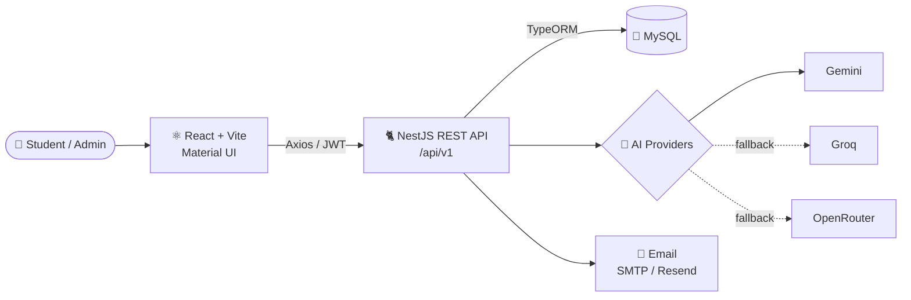

<!-- ===================== HEADER ===================== -->
<p align="center">
  
</p>

<p align="center">
  <a href="https://github.com/Bhagyaholkade/Learn-Loop.AI">
    
  </a>
</p>

<p align="center">
  
  
  
  
  
  
  
  
</p>

<p align="center">
  
  
  
  
</p>

<p align="center">
  <a href="#-overview">Overview</a> •
  <a href="#-features">Features</a> •
  <a href="#-architecture">Architecture</a> •
  <a href="#-tech-stack">Tech Stack</a> •
  <a href="#-getting-started">Getting Started</a> •
  <a href="#-api-documentation">API Docs</a> •
  <a href="#-project-structure">Structure</a>
</p>


## ✨ Overview


**LearnLoop AI** is a full-stack e-learning platform where **admins build courses with the help of AI** and **students learn, take quizzes, chat with an AI tutor and earn certificates**.

Course outlines, lesson content and chapter quizzes can be generated automatically — a complete course can be ready in **minutes**, not days.

> 🧠 *Create → 📚 Learn → 📝 Practice → 📈 Improve → 🔁 Repeat* — that's the **Learn Loop**.

<br clear="right" />


## 🚀 Features

### 🤖 AI-Powered

| Feature | Description |
| --- | --- |
| 🧩 **AI Course Creator** | Generate full course outlines and lesson content from a single topic |
| 📝 **AI Quiz Generator** | Create quizzes for one chapter or for every chapter at once |
| 💬 **AI Learning Assistant** | Chat-based tutor that answers questions while students learn |
| 🔁 **Multi-provider fallback** | Google Gemini → Groq → OpenRouter, so generation keeps working if one provider fails |
| ✅ **Draft & review** | Review, edit and approve AI drafts before publishing |

<table>
<tr>
<td width="50%" valign="top">

### 👨‍🎓 For Students
- 📚 Browse and enroll in courses
- 📖 Step-by-step lessons organized by chapters
- ⏱️ Timed quizzes with instant results & explanations
- 🗂️ Full history of quiz attempts
- 📈 Personal progress tracking
- 🔖 Bookmarks and ⭐ course reviews
- 🏆 Certificates on course completion
- 👤 Profile & settings management

</td>
<td width="50%" valign="top">

### 🛠️ For Admins
- 🗂️ Manage courses, chapters, lessons & enrollments
- 👥 Manage students
- 🧠 Create, review and manage quizzes & questions
- 📊 Analytics dashboard
- 🧾 Quiz attempts, results & progress reports
- ✨ One-click AI course and quiz generation

</td>
</tr>
</table>

### 🔐 Security & Accounts
- 🔑 JWT authentication with role-based access (**Admin / Student**)
- 📧 Registration OTP & email verification
- 🔄 Forgot / reset password flow (SMTP or Resend)
- 🧂 Password hashing with bcrypt
- 🛡️ Global request validation and error handling


## 🏗️ Architecture




## 🧰 Tech Stack

<p align="center">
  <a href="https://skillicons.dev">
    
  </a>
</p>

| Layer | Technology |
| --- | --- |
| 🎨 **Frontend** | React 19, TypeScript, Vite, Material UI, React Router, Axios |
| ⚙️ **Backend** | NestJS, TypeScript, TypeORM, Passport JWT, class-validator |
| 🗄️ **Database** | MySQL with TypeORM migrations |
| 🤖 **AI** | Google Gemini, Groq, OpenRouter |
| 📧 **Email** | Nodemailer (SMTP), Resend |
| 📘 **API Docs** | Swagger / OpenAPI |


## ⚡ Getting Started

### 📋 Prerequisites
- **Node.js** 20 or newer
- **MySQL** 8 or newer
- An API key for **Google Gemini** (Groq and OpenRouter are optional fallbacks)

### 1️⃣ Clone the repository
```bash
git clone https://github.com/Bhagyaholkade/Learn-Loop.AI.git
cd Learn-Loop.AI
```

### 2️⃣ Run the backend
```bash
cd backend
npm install
cp .env.example .env      # then fill in your values
npm run migration:run     # create database tables
npm run start:dev         # 🚀 http://localhost:3002
```

### 3️⃣ Run the frontend
```bash
cd frontend
npm install
npm run dev               # 🌐 http://localhost:5173
```

> 💡 The frontend reads the API URL from `VITE_API_BASE_URL` (default `http://localhost:3002/api/v1`).


## 🔑 Environment Variables

Copy `backend/.env.example` to `backend/.env` and fill in:

| Variable | Description |
| --- | --- |
| `PORT` | Backend port (default `3002`) |
| `FRONTEND_URL` | Allowed CORS origin (default `http://localhost:5173`) |
| `DB_HOST`, `DB_PORT`, `DB_USERNAME`, `DB_PASSWORD`, `DB_DATABASE` | MySQL connection |
| `JWT_SECRET` | Secret used to sign JWT tokens |
| `GEMINI_API_KEY`, `GEMINI_MODEL` | Google Gemini settings |
| `GROQ_API_KEY`, `OPENROUTER_API_KEY` | Optional AI fallbacks |
| `MAIL_PROVIDER`, `MAIL_*`, `RESEND_API_KEY` | Email settings |

> ⚠️ Never commit your real `.env` file.


## 📘 API Documentation

With the backend running, open the interactive Swagger docs:

<p align="center">
  <b>👉 <code>http://localhost:3002/api/docs</code> 👈</b>
</p>

All endpoints use the base path `/api/v1`. Click **Authorize** in Swagger and paste a JWT token to try protected routes.


## 📂 Project Structure

```
Learn-Loop.AI/
├── 🐈 backend/                  # NestJS REST API
│   └── src/
│       ├── ai-assistant/        # AI Learning Assistant (chat)
│       ├── ai-course/           # AI course outline & lesson generation
│       ├── ai-quiz/             # AI quiz generation (Gemini/Groq/OpenRouter)
│       ├── auth/                # JWT auth, roles, OTP, password reset
│       ├── email/               # Email service & templates
│       ├── courses/             # Courses
│       ├── chapters/            # Chapters
│       ├── lessons/             # Lessons
│       ├── quizzes/             # Quizzes, questions & attempts
│       ├── enrollments/         # Enrollments
│       ├── progress/            # Learning progress
│       ├── certificates/        # Certificates
│       ├── bookmarks/           # Bookmarks
│       ├── reviews/             # Course reviews
│       ├── students/            # Student management
│       ├── users/               # Users
│       ├── common/              # Filters & shared utilities
│       └── migrations/          # Database migrations
│
└── ⚛️ frontend/                 # React + Vite app
    └── src/
        ├── api/                 # API clients (Axios)
        ├── components/          # Shared & auth components
        ├── pages/               # Student & admin pages
        ├── services/            # API service setup
        ├── types/               # TypeScript types
        └── theme.ts             # MUI theme
```


## 📜 Useful Scripts

<table>
<tr>
<td valign="top">

**🐈 Backend** (`/backend`)

| Command | Description |
| --- | --- |
| `npm run start:dev` | Start in watch mode |
| `npm run build` | Build for production |
| `npm run start:prod` | Run the production build |
| `npm run migration:run` | Run database migrations |
| `npm run test` | Run unit tests |

</td>
<td valign="top">

**⚛️ Frontend** (`/frontend`)

| Command | Description |
| --- | --- |
| `npm run dev` | Start the dev server |
| `npm run build` | Build for production |
| `npm run preview` | Preview the production build |
| `npm run lint` | Lint the code |

</td>
</tr>
</table>


## 🤝 Contributing

Contributions, issues and feature requests are welcome!

1. 🍴 Fork the project
2. 🌿 Create your branch: `git checkout -b feature/amazing-feature`
3. 💾 Commit your changes: `git commit -m "feat: add amazing feature"`
4. 🚀 Push the branch: `git push origin feature/amazing-feature`
5. 🔃 Open a Pull Request

<div align="center">

### ⭐ If you like this project, give it a star!


</div>

<!-- ===================== FOOTER ===================== -->
<p align="center">
  
</p>
